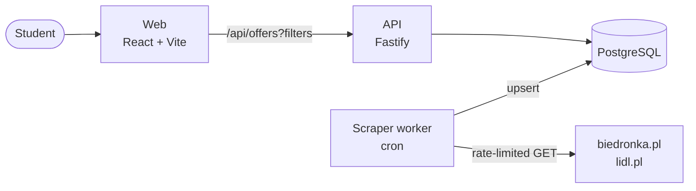
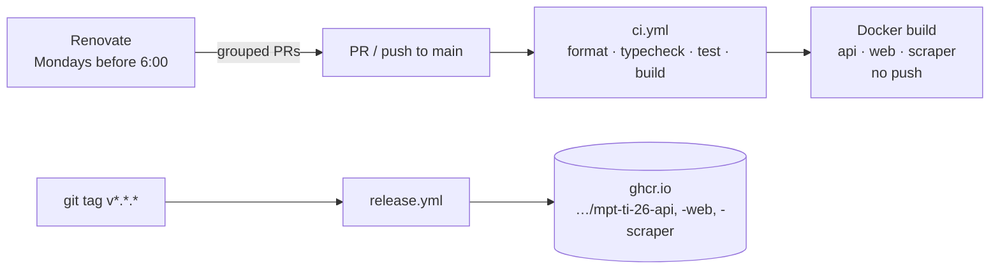

# MPT-TI-26 - Promki dla studenta

A repository for creating a project as part of the Metodyki Projektów Teleinformatycznych course at AGH UST.

A web app that collects current promotions from **Biedronka** and **Lidl** in one place
and lets students filter them by what actually matters on a student budget: price,
price per kg/l, discount, category, and whether the deal needs a loyalty app.

## Why / who is it for

Weekly leaflets are long, split across stores, and full of conditions
("2+1", "z aplikacją", "od czwartku"). A student wants a quick answer to
_"what's the cheapest pasta / coffee / protein this week, and where?"_

## Usage scenarios

| #   | As a student I want to…                                               | Feature                                |
| --- | --------------------------------------------------------------------- | -------------------------------------- |
| 1   | see all current promos from both stores in one list                   | Unified offer grid                     |
| 2   | show only food under 5 zł                                             | Filters: category, max price           |
| 3   | compare real value, not sticker price                                 | Sort by **price per kg / l / szt.**    |
| 4   | hide deals that need Lidl Plus / Moja Biedronka                       | "No app required" toggle               |
| 5   | see what's valid **today** vs. starting Thursday                      | Validity date filter                   |
| 6   | send my flatmate a link to "cheap coffee this week"                   | Filters stored in URL → shareable      |
| 7   | _(later)_ save a filter and get notified when a matching deal appears | Accounts, saved filters, e-mail alerts |
| 8   | _(later)_ build a shopping list split by store                        | Shopping list                          |

### Filters (MVP)

- **Search** by product name
- **Store**: Biedronka / Lidl (multi-select)
- **Category**: food groups mapped to a common list (makaron, nabiał, mięso, napoje, chemia…)
- **Max price** (zł) and **min discount** (%)
- **Valid on** date (default: today)
- **Exclude app-only** deals
- **Sort**: biggest discount · lowest price · lowest price per unit · ending soonest

### UX sketch

```
┌───────────────────────────────────────────────────────────┐
│  Promki dla studenta            [ szukaj: "kawa"      🔍 ] │
├──────────────┬────────────────────────────────────────────┤
│ Sklep        │  Sort: [ cena/kg ▼ ]          42 wyniki    │
│ ☑ Biedronka  │  ┌────────┐ ┌────────┐ ┌────────┐          │
│ ☑ Lidl       │  │  img   │ │  img   │ │  img   │          │
│ Kategoria    │  │ Kawa…  │ │ Kawa…  │ │ Kawa…  │          │
│ ☐ Nabiał     │  │ 12,99zł│ │ 14,49zł│ │ 9,99zł │          │
│ ☑ Napoje     │  │ -35%   │ │ -20%   │ │ 📱 app │          │
│ Max cena [ ] │  │ 51,96/kg│ │ 57,96/kg│ │ 39,96/kg│        │
│ ☐ bez apki   │  │ do 26.10│ │ do 29.10│ │ do 26.10│        │
│ Ważne: dziś  │  └────────┘ └────────┘ └────────┘          │
└──────────────┴────────────────────────────────────────────┘
```

Mobile-first: on phones the filter panel collapses into a bottom sheet — most
students will check this in the shop.

## Tech stack

Everything is **TypeScript** in one **npm workspaces** monorepo, so the offer
type and filter schema are defined once (`packages/shared`) and used by the
scraper, API and frontend.

| Layer           | Choice                                       | Why                                                                 |
| --------------- | -------------------------------------------- | ------------------------------------------------------------------- |
| Language        | TypeScript (Node 24 LTS)                     | One language for the whole team; types catch scraper/API mismatches |
| Package manager | npm workspaces                               | Ships with Node, no extra tooling to install                        |
| Frontend        | React 18 + Vite                              | Fast dev server, huge ecosystem, easy to find help                  |
| Data fetching   | TanStack Query                               | Caching, loading/error states for free                              |
| UI _(planned)_  | Tailwind CSS + shadcn/ui                     | Quick responsive layout, accessible components                      |
| API             | Fastify                                      | Fast, TS-friendly, schema validation                                |
| Validation      | zod                                          | Shared schemas for scraper output and API query params              |
| Database        | PostgreSQL 17                                | Filtering/sorting/full-text search are SQL's strengths              |
| ORM _(planned)_ | Drizzle (or Prisma)                          | Type-safe queries and migrations                                    |
| Scraping        | fetch + Cheerio; Playwright when needed      | Cheerio for static HTML; Playwright only for JS-rendered pages      |
| Scheduling      | node-cron                                    | Simple; upgrade to BullMQ + Redis only if needed                    |
| Containers      | Docker + docker compose                      | Whole stack starts with one command on any laptop                   |
| CI/CD           | GitHub Actions + GHCR, Renovate              | Checks on every PR, images on tag, automated dependency updates     |
| Tests           | Vitest; scraper tests on saved HTML fixtures | Scraper tests don't hit live sites                                  |

**Alternatives considered:** Next.js (merges frontend+API, but blurs the
boundary for a team split into frontend/backend/scraper roles); Python +
Scrapy for the scraper (great tool, but a second language and duplicated types).

## Architecture



The scraper runs on a schedule and writes to the database; the API only reads.
Users never trigger scraping. Full diagrams (pipeline, request sequence, data
model): **[docs/architecture.md](docs/architecture.md)**.

## Repository layout

```
.
├── apps/
│   ├── web/        React + Vite frontend (nginx in Docker)
│   ├── api/        Fastify REST API
│   └── scraper/    Scheduled worker; one adapter per store in src/adapters/
├── packages/
│   └── shared/     zod schemas + types (Offer, OfferFilters) used everywhere
├── docs/           Architecture & design notes
├── docker-compose.yml
└── tsconfig.base.json
```

## Getting started

Requirements: Node ≥ 22 (24 recommended, see `.nvmrc`), Docker.

```bash
cp .env.example .env
npm install

# Option A — everything in Docker
docker compose up --build
#   web: http://localhost:8080   api: http://localhost:3000/api/health

# Option B — local dev with hot reload (DB in Docker)
docker compose up -d db
npm run dev            # api :3000, web :5173, scraper on cron
npm run scrape:once -w @promo/scraper   # run scrapers immediately
```

Other scripts: `npm test`, `npm run build`, `npm run typecheck`, `npm run format`.

## CI/CD



| Workflow                        | Trigger              | What it does                                                         |
| ------------------------------- | -------------------- | -------------------------------------------------------------------- |
| `.github/workflows/ci.yml`      | every PR, `main`     | `npm ci`, Prettier check, typecheck, `npm test`, build, Docker build |
| `.github/workflows/release.yml` | tag `v*.*.*`, manual | Builds and pushes all three images to GitHub Container Registry      |
| `renovate.json`                 | weekly               | Grouped PRs for npm deps, GitHub Actions and Docker base images      |

Releasing: `git tag v0.1.0 && git push origin v0.1.0`.

### Deployment environments

`release.yml` runs in a GitHub Environment, so each publish shows up under
the repo's **Deployments** and can be gated:

| Environment  | Used by                     | Suggested protection (Settings → Environments)       |
| ------------ | --------------------------- | ---------------------------------------------------- |
| `production` | tag pushes `v*.*.*`         | Required reviewers; deployment tags `v*.*.*` only    |
| `staging`    | manual run (`Run workflow`) | None — for testing images from a branch before a tag |

GitHub creates both environments on first use. Put deploy-time secrets and
variables (e.g. `DATABASE_URL`, `SCRAPE_CRON`) on the environment rather than
the repo, so staging and production can differ.

## Roadmap

1. **Environment** — monorepo, Docker, shared types _(this commit)_
2. **Scraper MVP** — real Biedronka + Lidl adapters, HTML fixtures, tests
3. **Database** — Drizzle schema + migrations, scraper upserts, API reads from DB
4. **Filters & UI** — filter panel, URL state, offer cards, mobile layout
5. **Quality** — CI, lint, scrape-run monitoring (alert when an adapter returns 0 offers)
6. **Extras** — accounts, saved filters with e-mail alerts, shopping list, more stores

## Scraping etiquette & legal note

This is an educational project. The scraper must:

- check and respect each site's `robots.txt` and terms of use,
- run rarely (daily is plenty — leaflets change weekly) with delays between requests,
- identify itself with an honest `User-Agent`,
- store only offer data (name, price, dates, link) and always link back to the source.

Store websites change without notice — expect adapters to break and keep them
small and covered by fixture-based tests.

## License

MIT — see [LICENSE](LICENSE).
