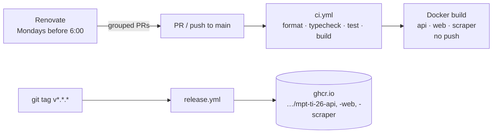

# MPT-TI-26

A repository for creating a project as part of the Metodyki Projektów Teleinformatycznych course at AGH UST.

A web app that collects current promotions from **Biedronka** and **Lidl** in one place
and lets students filter them by what actually matters on a student budget: price,
price per kg/l, discount, category, and whether the deal needs a loyalty app.

## Why / who is it for

A student wants a quick answer to "what's the cheapest pasta / coffee / protein this week, and where?"

## Tech stack (planned)

Everything is TypeScript/Python in one npm workspaces monorepo, so the offer
type and filter schema are defined once (`packages/shared`) and used by the
scraper, API and frontend.

| Layer      | Choice                                       | Why                                                                 |
| ---------- | -------------------------------------------- | ------------------------------------------------------------------- |
| Language   | TypeScript                                   | One language for the whole team; types catch scraper/API mismatches |
| Frontend   | React + Vite                                 | Fast dev server, huge ecosystem, easy to find help                  |
| API        | Fastify                                      | Fast, TS-friendly, schema validation                                |
| Database   | PostgreSQL                                   | Filtering/sorting/full-text search are SQL's strengths              |
| Scraping   | fetch + Cheerio; Playwright when needed      | Cheerio for static HTML; Playwright only for JS-rendered pages      |
| Scheduling | node-cron                                    | Simple; upgrade to BullMQ + Redis only if needed                    |
| Containers | Docker + docker compose                      | Whole stack starts with one command on any laptop                   |
| CI/CD      | GitHub Actions + GHCR, Renovate              | Checks on every PR, images on tag, automated dependency updates     |
| Tests      | Vitest; scraper tests on saved HTML fixtures | Scraper tests don't hit live sites                                  |

## Repository layout

```
.
├── apps/
│   ├── web/        React + Vite frontend (nginx in Docker)
│   ├── api/        Fastify REST API
│   └── scraper/    Scheduled worker; one adapter per store in src/adapters/
├── packages/
│   └── shared/     types (Offer, OfferFilters)
├── docs/           Architecture & design notes
├── docker-compose.yml
└── tsconfig.base.json
```

## Getting started

Requirements: Node ≥ 22 (24 recommended, see `.nvmrc`), Docker.

```bash
cp .env.example .env
npm install

# Option A — everything in Docker
docker compose up --build
#   web: http://localhost:8080   api: http://localhost:3000/api/health

# Option B — local dev with hot reload (DB in Docker)
docker compose up -d db
npm run dev            # api :3000, web :5173, scraper on cron
npm run scrape:once -w @promo/scraper   # run scrapers immediately
```

Other scripts: `npm test`, `npm run build`, `npm run typecheck`, `npm run format`.

## CI/CD



| Workflow                        | Trigger              | What it does                                                         |
| ------------------------------- | -------------------- | -------------------------------------------------------------------- |
| `.github/workflows/ci.yml`      | every PR, `main`     | `npm ci`, Prettier check, typecheck, `npm test`, build, Docker build |
| `.github/workflows/release.yml` | tag `v*.*.*`, manual | Builds and pushes all three images to GitHub Container Registry      |
| `renovate.json`                 | weekly               | Grouped PRs for npm deps, GitHub Actions and Docker base images      |

Releasing: `git tag v0.1.0 && git push origin v0.1.0`.

### Deployment environments

`release.yml` runs in a GitHub Environment, so each publish shows up under
the repo's Deployments and can be gated:

| Environment  | Used by                     |
| ------------ | --------------------------- |
| `production` | tag pushes `v*.*.*`         |
| `staging`    | manual run (`Run workflow`) |

[](https://github.com/mateuszoleksy/MPT-TI-26/actions/workflows/release.yml)

## Scraping etiquette & legal note

This is an educational project. The scraper must:

- check and respect each site's `robots.txt` and terms of use,
- run rarely
- store only offer data (name, price, dates, link) and always link back to the source.

Store websites change without notice.

## License

MIT — see [LICENSE](LICENSE).
