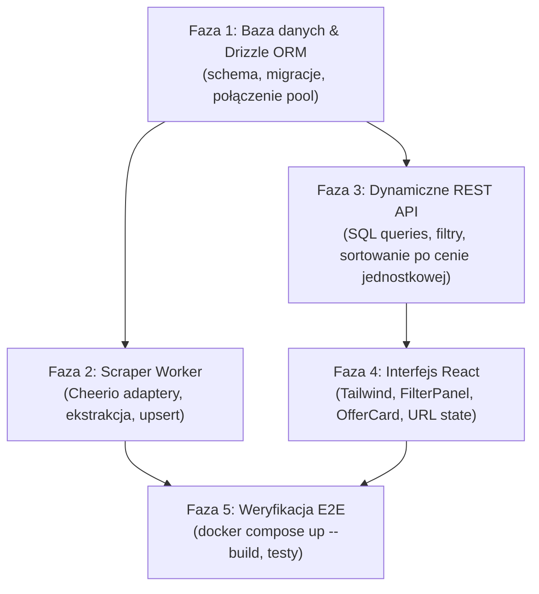

# Plan Techniczny Implementacji MVP (Implementation Plan)

> **Zadanie:** MPT26-12 — Zaplanowanie ścieżki służącej osiągnięciu działającej aplikacji (MVP)  
> **Projekt:** Promki dla studenta (`MPT-TI-26`)  
> **Stos:** TypeScript, npm workspaces, React 18 + Vite, Fastify, PostgreSQL 17, Cheerio, node-cron

---

## 1. Analiza stanu obecnego (As-Is)

### Co jest zrobione i skonfigurowane:
1. **Monorepo (npm workspaces):**
   - Trzy aplikacje: `apps/api` (Fastify), `apps/scraper` (Node worker), `apps/web` (React/Vite) oraz pakiet `packages/shared`.
   - Wspólny `tsconfig.base.json` (ES2022, NodeNext, strict) oraz formatowanie Prettier.
2. **Współdzielone kontrakty (`@promo/shared`):**
   - Zdefiniowane schematy Zod: `OfferSchema` (model promocji) i `OfferFiltersSchema` (parametry filtrowania/paginacji).
   - Testy jednostkowe w Vitest sprawdzające walidację i helper `discountPercent()`.
3. **Szkielety aplikacji:**
   - `apps/api`: Fastify z CORS, endpoint `/api/health`, endpoint `/api/offers` zwracający in-memory mock `sample`.
   - `apps/scraper`: struktura adapterów (`StoreAdapter`), pętla harmonogramu `node-cron` oraz flaga `--once`.
   - `apps/web`: React 18 z Vite i `@tanstack/react-query`, prosta lista `<ul>` z fetch do `/api/offers`.
4. **Infrastruktura:**
   - `docker-compose.yml` z serwisami: `db` (Postgres 17 Alpine), `api`, `scraper`, `web`.
   - GitHub Actions CI (lint, typecheck, test, docker build).

### Luki do działającego MVP:
1. **Baza danych:** Brak biblioteki ORM (Drizzle), brak schematu tabel (`offers`, `categories`, `scrape_runs`) i migracji. Kontener wstaje pusty.
2. **Scraper:** Adaptery `biedronka.ts` i `lidl.ts` zwracają `[]`. Brak parsowania Cheerio i brak zapisu (`UPSERT`) do bazy.
3. **API:** `/api/offers` zwraca sztywny mock zamiast zapytań SQL z klauzulami `WHERE`, `ORDER BY`, `LIMIT/OFFSET`.
4. **Frontend:** Brak biblioteki CSS (Tailwind), brak komponentów kart ofert (`OfferCard`), brak panelu filtrów i synchronizacji z parametrami URL (`URLSearchParams`).

---

## 2. Plan implementacji krok po kroku (To-Be)



---

### Faza 1: Baza danych i Drizzle ORM (Zadania MPT26-14, MPT26-7)

1. **Instalacja zależności w `apps/api` (lub nowym pakiecie `packages/db`):**
   ```bash
   npm install drizzle-orm pg -w @promo/api
   npm install drizzle-kit @types/pg -D -w @promo/api
   ```
2. **Stworzenie schematu bazy `apps/api/src/db/schema.ts`:**
   - Tabela `categories`: `id` (PK, text), `name` (text).
   - Tabela `offers`: kolumny zgodne z `OfferSchema` (`store_id`, `source_id`, `name`, `price_promo`, `price_regular`, `unit`, `unit_quantity`, `requires_app`, `valid_from`, `valid_to`), z unikalnym indeksem `UNIQUE(store_id, source_id, valid_from)`.
   - Tabela `scrape_runs`: historia uruchomień scrapera.
3. **Konfiguracja Drizzle Kit (`apps/api/drizzle.config.ts`) i generowanie migracji:**
   ```bash
   npx drizzle-kit generate
   npx drizzle-kit migrate
   ```
4. **Klient bazy:** Inicjalizacja puli połączeń `pg.Pool` i klienta Drizzle w `apps/api/src/db/index.ts`.

---

### Faza 2: Implementacja Scrapera (Zadania MPT26-16, MPT26-19, MPT26-21)

1. **Fixtures testowe:** Zapisanie przykładowych podstron HTML Biedronki i Lidla do `apps/scraper/src/adapters/__fixtures__/`.
2. **Implementacja `apps/scraper/src/adapters/biedronka.ts`:**
   - Pobieranie zawartości i ładowanie do `cheerio.load(html)`.
   - Ekstrakcja pól: nazwa, ceny, jednostka przeliczeniowa, daty obowiązywania (`validFrom`, `validTo`).
   - Wykrywanie flagi `requiresApp` (np. oznaczenia "Tylko z kartą / aplikacją").
3. **Implementacja `apps/scraper/src/adapters/lidl.ts`:**
   - Obsługa specyficznych selektorów Lidla i weryfikacja wymogu aplikacji Lidl Plus.
4. **Zapis do bazy danych:**
   - Wdrożenie zapisu w `apps/scraper/src/index.ts` przy użyciu idempotencyjnego zapytania:
     `INSERT INTO offers (...) VALUES (...) ON CONFLICT (store_id, source_id, valid_from) DO UPDATE SET ...`
   - Rejestracja wyniku w tabeli `scrape_runs`.

---

### Faza 3: Dynamiczne REST API (Zadania MPT26-16, MPT26-18)

1. **Helper ceny jednostkowej w `@promo/shared`:**
   ```typescript
   export function pricePerUnit(o: Pick<Offer, 'pricePromo' | 'unit' | 'unitQuantity'>): number | null {
     if (!o.unit || !o.unitQuantity || o.unitQuantity <= 0) return null;
     return o.pricePromo / o.unitQuantity;
   }
   ```
2. **Obsługa filtrów w `apps/api/src/index.ts`:**
   - Filtrowanie po sklepach (`store`), cenie maksymalnej (`maxPrice`), braku aplikacji (`excludeAppOnly`), aktywności w dniu (`activeOn`).
   - Wyszukiwanie tekstowe `ilike(offers.name, '%q%')`.
   - Sortowanie: największa zniżka, najniższa cena, cena za jednostkę, data wygaśnięcia.
   - Paginacja: `limit` i `offset`.

---

### Faza 4: Interfejs Użytkownika (Zadania MPT26-17, MPT26-18, MPT26-20)

1. **Instalacja stylizacji:**
   ```bash
   npm install tailwindcss @tailwindcss/vite -D -w @promo/web
   ```
2. **Struktura komponentów w `apps/web/src/`:**
   - `components/SearchBar.tsx`: pole tekstowe z debouncingiem.
   - `components/FilterPanel.tsx`: wielokrotny wybór sklepu, kategoria, suwak ceny, checkbox "bez aplikacji".
   - `components/OfferCard.tsx`: karta promocji prezentująca zdjęcie, badge sklepu, % rabatu, cenę, przelicznik za kg/l oraz warunki ("2+1 gratis").
   - `components/OfferGrid.tsx`: responsywna siatka kart z obsługą stanu ładowania i braku wyników.
3. **Zarządzanie stanem (URL jako źródło prawdy):**
   - Synchronizacja parametrów formularza z `useSearchParams` w celu obsługi udostępniania linków z wynikami.

---

### Faza 5: Integracja i Weryfikacja

1. Uruchomienie całości stosu:
   ```bash
   docker compose up --build
   ```
2. Sprawdzenie przepływu end-to-end:
   - Scraper pobiera oferty i zapisuje je w bazie.
   - API udostępnia zwalidowane oferty z bazy pod `/api/offers`.
   - Frontend poprawnie filtruje, sortuje i prezentuje dane.
